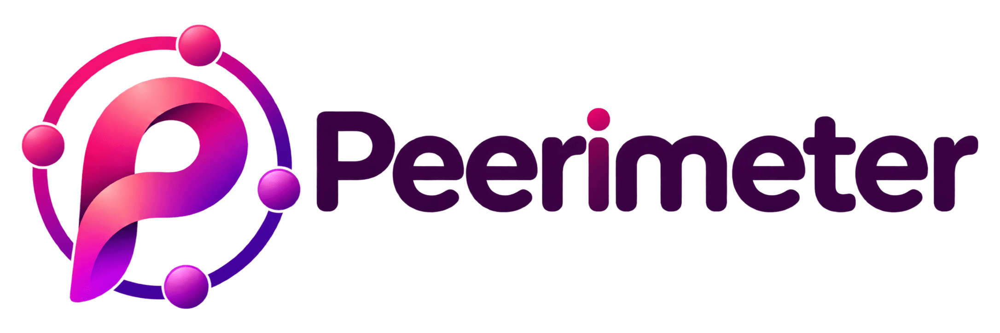

  

# Peerimeter

Peerimeter is a self-hosted WireGuard mesh agent for direct peer-to-peer connections. The offline cross-platform agent is implemented; the control plane is planned for a later milestone.

The project is organized around two independent repositories:

- **peerimeter-agent** — a headless Go agent and background service targeting Linux, macOS, and Windows. The first milestone is offline WireGuard connectivity using local static JSON configuration.
- **peerimeter-service** — a Go control plane with a REST API, PostgreSQL, MQTT coordination, and an embedded React dashboard with GitHub sign-in, planned after the offline agent milestone.

Later milestones cover STUN-assisted endpoint discovery, connection recovery, and gateways for standard WireGuard clients. Connections are direct only: there is no relay fallback, so restrictive NAT or firewalls may prevent connectivity.

**Status:** Phase 1 offline agent complete and natively verified on Linux, macOS and Windows. The standalone STUN probe is an in-progress Phase 1 add-on; the service/control plane has not started.

**Website:** [peerimeter.app](https://peerimeter.app) · [Agent installer](https://agent.peerimeter.app) (release packages will be available after the first public release).

See [the implementation plan](https://github.com/peerimeter/.github/blob/main/docs/planning/plan.md), [additional requirements](https://github.com/peerimeter/.github/blob/main/docs/planning/additional-plan.md), and [progress tracker](https://github.com/peerimeter/.github/blob/main/docs/planning/progress.md).

## GitHub pull request settings

Checked through the GitHub REST API on **2026-11-14**. Both repositories allow
auto-merge and rebase-only merges, require linear history, and delete branches
after merge. Neither requires an approving review, and admin enforcement is off.

| Repository | Required status checks on `main` | Require up-to-date branch | Require all review conversations resolved |
| --- | --- | --- | --- |
| [`peerimeter/.github`](https://github.com/peerimeter/.github) | `CodeRabbit` | No (`strict: false`) | No (API reports disabled) |
| [`peerimeter/peerimeter-agent`](https://github.com/peerimeter/peerimeter-agent) | `check`, `CodeRabbit` | Yes (`strict: true`) | No (API reports disabled) |

The settings are not identical: the agent repository also requires the
pipeline's aggregate `check` and strict up-to-date branches. The `.github`
repository does not currently require branches to be up to date, and neither
repository currently enforces conversation resolution. These settings do not
match the intended policy. Until branch protection is updated, inspect, address
and resolve every PR review conversation and update the PR branch before
enabling auto-merge; never rely on current GitHub settings to enforce these
requirements. Refresh this summary when repository rules change.
