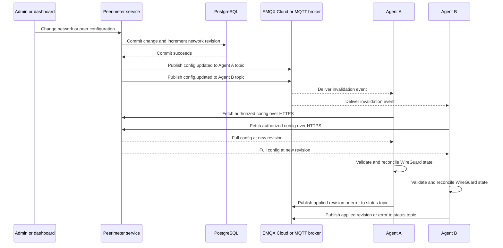
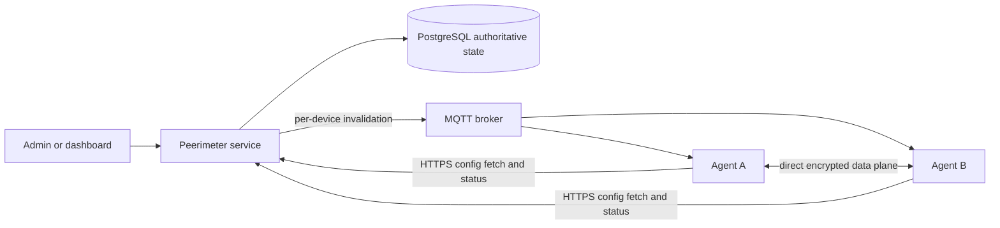
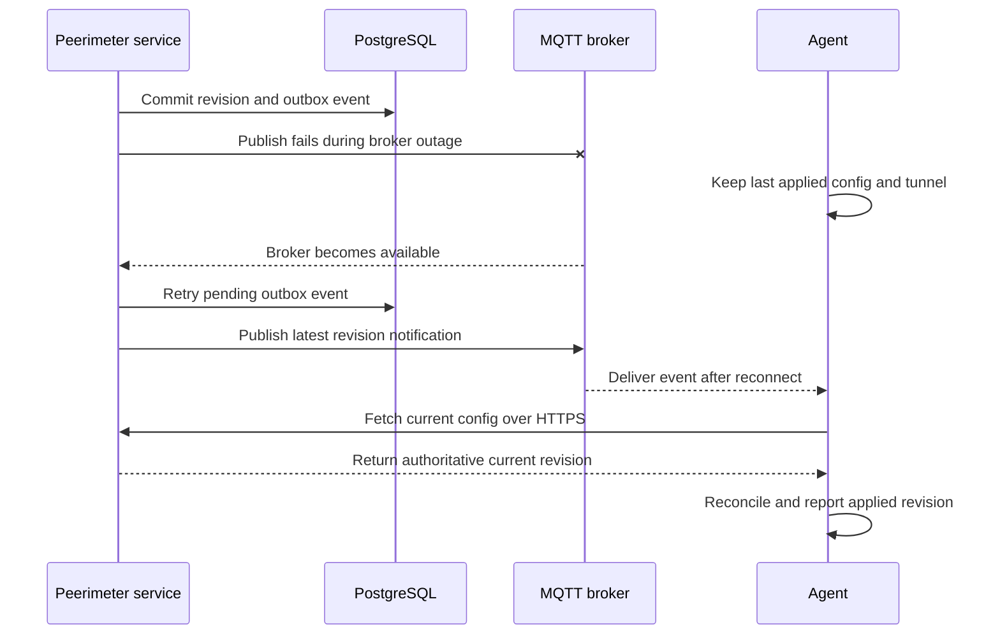

# Peerimeter — Implementation Plan for Codex CLI

> **Purpose:** This file is the implementation contract for an AI coding agent (Codex CLI). Build an open-source-friendly, self-hosted, WireGuard-based mesh VPN control plane and cross-platform background agent. Follow the phases and acceptance criteria below. Implement working, tested increments rather than scaffolding the entire project without usable functionality.
>
> **Scope decision:** **NO RELAY** in this project. Do not implement or scaffold a relay server, DERP, TURN, or automatic relay fallback. Direct WireGuard links only. If NAT/firewall conditions prevent direct connectivity, report the failure clearly and provide diagnostics instead of claiming connectivity can always be restored.

## 0. Operating instructions for Codex

### Agent responsibilities

- **Implementation:** Luna.
- **Phase planning and independent review:** Sol.
- Keep review separate from the implementation author. Record the actual reviewer/model and reviewed SHA in `progress.md`; do not retroactively attribute earlier reviews to a model that was not identified.

1. Inspect both repository directories first (if present). Preserve existing decisions and code unless they conflict with this plan. If the repository is empty, initialize it according to the structure below.
2. Work **phase by phase** and in small, reviewable changes. **First deliver static-JSON, API-free direct WireGuard connectivity on Linux, macOS, and Windows** before implementing the server, enrollment, MQTT, STUN or browser UI.
3. Before each phase: briefly state the goal, files/modules to change, tests to add, and important risks. After each phase: run relevant tests and report outcomes, limitations, and next steps.
4. Keep each repository independently buildable throughout. Do not commit broken placeholder implementations, fake connectivity metrics, or nonfunctional commands presented as working features.
5. Prefer simple, well-maintained dependencies. Pin versions in manifests; verify current library APIs before integrating them.
6. Never check private keys, tokens, generated client configurations, or production secrets into git. Include `.env.example`, not `.env`.
7. All public-facing API payloads must be versioned and validated. Use structured JSON logs, context propagation, graceful shutdown, and explicit errors.
8. For operations requiring root/admin permissions or unavailable network devices, implement interfaces and unit tests with fakes, plus optional integration tests gated by environment variables. Do not weaken or skip security checks just to pass tests.
9. Document what genuinely works per OS. Do not label Windows/macOS support complete until verified with real platform-specific integration tests.
10. **Do not expand the scope** to desktop apps, mobile apps, relay, exit nodes, MagicDNS, Kubernetes, HA, or sophisticated service-level ACLs unless explicitly requested later.
11. If implementing everything in one run is not feasible, finish the current coherent phase, update the progress checklist in this document, and summarize remaining work. Do not silently claim phases are complete.
12. **Mandatory phase-end independent review:** Before marking any phase complete from this point onward, run a separate review agent that did not implement the changes it reviews. Give it the phase requirements, final code/diff, tested commit SHA, native test evidence and documented limitations. A different model may be used when available; record the actual reviewer/model rather than assuming model diversity. Review requirement coverage, correctness, security, lifecycle/cleanup, tests and accuracy of documentation/status claims. Fix findings that block correctness, security or phase acceptance, rerun affected checks, and have the reviewer verify those fixes. Record the reviewed SHA, findings, resolutions, remaining explicitly deferred items and final review outcome in progress.md. Do not mark a phase complete while blocking findings remain; do not represent self-review or a passing CI job as an independent agent review. This gate applies to the ongoing Phase 1 and subsequent phases; earlier Phase 0 evidence remains historical.


## 1. Product goals and non-goals

### Goals

- Self-hosted Netmaker-like **WireGuard full mesh** between registered devices.
- Go-based central server (`peerimeter-service`) exposing authenticated REST API and serving an embedded web dashboard.
- Go-based headless, continuously running CLI/service (`peerimeter-agent`) for Linux, macOS, and Windows, all three supported in the **first connectivity milestone**, without any API dependency, using local static JSON.
- Central authoritative desired-state configuration with monotonic revisioning; agents can always fetch their latest authorized configuration.
- MQTT-over-TLS event notifications for fast updates; lost notifications must be repaired by periodic reconciliation.
- Direct endpoint discovery via STUN, endpoint candidate exchange, NAT traversal/hole punching where practical, and robust reaction to local/public IP and port changes.
- Full handling of WireGuard state without restarting the interface on normal peer changes.
- GitHub OAuth **for dashboard users**; separate short-lived enrollment authorization and device authentication for agents.
- Modern browser-only React dashboard with network/peer management, observable peer graph, current state, and diagnostics.
- External **standard WireGuard clients** connecting to a selected Peerimeter gateway peer; initially NAT/SNAT mode, later optional routed mode. The gateway may forward only to explicitly authorized mesh destinations.
- Docker Compose deployment of server, PostgreSQL, and MQTT broker.

### Non-goals (initial releases)

- **Any relay functionality.** Direct WireGuard connectivity can fail under symmetric/endpoint-dependent NAT or restrictive UDP firewalls.
- Electron, Wails, Tauri, desktop UI, system tray, native mobile apps.
- Reimplementation of WireGuard cryptography or protocol.
- Transparent, guaranteed NAT traversal across all network types.
- A full ICE stack unless tests demonstrate a need and a specific design is approved.
- Full tunnel / internet exit node and site-to-site subnet routing outside gateway requirements.
- Multi-region, multi-server HA, billing, hosted SaaS.

## 2. Architecture

```text
                         Browser
                      (React dashboard)
                             |
                          HTTPS
                             |
                  +-----------------------+
                  | peerimeter-service (Go)  |
                  | REST API + GitHub SSO |
                  | Network & peer CRUD   |
                  | Enrollment & auth     |
                  | Config revisions      |
                  | Endpoint coordinator  |
                  | Diagnostics/status    |
                  | Embedded web assets   |
                  +-----------+-----------+
                              |
                   +----------+----------+
                   |                     |
                PostgreSQL           MQTT broker
                   |                (TLS, ACLs)
                   +----------+----------+
                              |
                   HTTPS / MQTT / STUN
                              |
                +-------------+-------------+
                |                           |
           +----v------------+        +-----v-----------+
           | peerimeter-agent  |        | peerimeter-agent  |
           | Linux/macOS/Win |<======>| Linux/macOS/Win |
           | headless daemon | direct | headless daemon|
           | WireGuard       |   WG   | WireGuard       |
           | STUN / recovery |        | STUN / recovery |
           +-----------------+        +-----------------+
```

**Data plane vs control plane:** peer-to-peer packets flow directly over WireGuard. The API, MQTT, and STUN serve only coordination; no server forwarding of ordinary mesh packets. Existing authorized tunnels should keep working during brief server/MQTT outages, subject to network changes and offline policy.

**Single source of truth:** PostgreSQL-backed server config. MQTT publishes invalidation/revision events; it is not authoritative config storage.

**Split state:** desired network membership, keys, IPs, routes, and policies are durable; observed endpoints, health, last handshake, and candidate validity are dynamic/ephemeral and must not cause an unnecessary global revision on every probe.

## 3. Technology choices

| Component | Default | Notes |
|---|---|---|
| Language | Go 1.27.4 | Exact required toolchain for development, native CI and release builds; one independent Go module per repository |
| HTTP | `net/http` + `chi` | Keep REST handlers thin |
| Agent CLI | `spf13/cobra` | Pin the verified stable version; use Cobra/pflag for subcommands, arguments, help and shell completion |
| Database | PostgreSQL | SQL migrations, `pgx` or `database/sql`; avoid excessive ORM magic |
| MQTT | Mosquitto | MQTT v5 or v3.1.1, QoS 1 for notifications; TLS + per-device authorization |
| WireGuard control | `wgctrl-go` | Linux kernel backend; OS-specific adapters for macOS/Windows |
| Linux OS networking | netlink | Interface IPs/routes/firewall management |
| STUN | `pion/stun` (or equivalent) | Validate UDP socket/mapping behavior before relying on discovered ports |
| Web | Vite + React + TypeScript | Static assets embedded in Go binary via `go:embed` |
| UI | Tailwind CSS + shadcn/ui | Peer graph via React Flow / XYFlow |
| Auth | GitHub OAuth authorization-code flow | Secure server-side session cookies; CSRF/state; PKCE when appropriate |
| Tests | Go `testing`, `httptest`, container/network integration tests | Browser E2E optional later |
| Deployment | Docker Compose | Server, PostgreSQL, Mosquitto, reverse proxy/TLS documented |

**Platform strategy:** Linux, macOS, and Windows in the first implementation milestone using static local JSON and no central server. macOS and Windows must use tested, officially supported WireGuard integration approaches; do not assume `wgctrl-go` can create adapters or manage routes on every OS. Encapsulate interface creation, lifecycle, addresses, routes, forwarding, and firewall in OS adapters.

**Go toolchain (mandatory from Phase 0):** Use **Go 1.27.4** consistently in both repositories, local development, all three native CI jobs, integration-test helpers and release builds. Pin the version explicitly in module/toolchain configuration and CI; do not use floating `stable` or silently upgrade to a different patch release. Future version changes require an explicit update to this plan and the corresponding build configuration.

**Windows driver installation (mandatory from Phase 1):** The `peerimeter-agent` installer must bundle the official, correctly signed WireGuardNT component for the target architecture and, with administrator privileges, arrange installation of the required driver before creating the first tunnel. Users must not need to download or manually install the separate WireGuard application or GUI. Use the officially supported WireGuardNT/embeddable integration, pin the bundled version, and verify its signature/integrity. Driver provisioning must work offline from the agent installation package so static mode has no installation-time download dependency. Verify the complete installation and native tunnel operation on a clean Windows runner without a preinstalled WireGuard package.

## 4. TWO INDEPENDENT GIT REPOSITORIES (mandatory)

This project is **not a monorepo**. Create and maintain exactly two separate Git repositories, with independent `go.mod`, CI pipelines, versioning, release artifacts, and issue tracking:

1. **`peerimeter-agent`** — headless Go CLI/background service, Linux/macOS/Windows WireGuard adapters, offline static JSON, and (later) enrollment/config sync, STUN and recovery. **Implement this repository first.**
2. **`peerimeter-service`** — central Go REST API, PostgreSQL migrations, MQTT event publishing, GitHub SSO, embedded React browser dashboard, and external-client/gateway management API. Implement after the agent's offline cross-platform milestone.

The directory containing the two repositories is only a local workspace, **not a third Git repository**:

```text
workspace/
├── plan.md                  # planning handoff; not its own git repo
├── additional-plan.md
├── progress.md              # overall progress; repo-specific status noted
├── codex-prompt.md
├── peerimeter-agent/           # its own .git and go.mod
│   ├── .git/
│   ├── go.mod
│   ├── cmd/peerimeter-agent/main.go
│   ├── internal/
│   │   ├── agent/{cli,daemon,control,connectivity,discovery,wireguard,routing,gateway,state,ipc}/
│   │   └── platform/{linux,darwin,windows}/
│   ├── pkg/{protocol,models}/
│   ├── examples/
│   ├── tests/{integration,network,e2e}/
│   └── README.md
└── peerimeter-service/         # its own .git and go.mod
    ├── .git/
    ├── go.mod
    ├── cmd/peerimeter-service/main.go
    ├── internal/service/{api,auth,enrollment,networks,peers,config,discovery,gateways,events,storage}/
    ├── pkg/{protocol,models}/
    ├── web/{src,package.json}/
    ├── migrations/
    ├── deployments/{compose.yaml,mosquitto/}/
    ├── tests/{integration,e2e}/
    └── README.md
```

**Interface naming:** Linux defaults to `pm-$networkName`, with the 15-byte safe algorithm and explicit local override from `additional-plan.md`.

**Cross-repo contract:** Do not use `replace ../peerimeter-*`, cross-repo `internal/` imports, symlinks, or vendored source as the long-term integration strategy. Define a versioned HTTP/JSON and MQTT message contract (OpenAPI + JSON schemas, or generated versioned Go client package) owned by `peerimeter-service`, with pinned releases or schema snapshots consumed by `peerimeter-agent`. Schema evolution must be backward compatible or versioned explicitly. Use contract compatibility tests on both repositories. For P0/P1 the agent must compile and function without cloning the service repository or obtaining any server schema.

**Coordination:** Make commits only in the affected repository, and record each repository's commit hash, test results and current milestone separately in `progress.md`. Do not imply cross-repo atomic commits. The service owns persistence and authentication; the agent owns all OS network operations. Keep `peerimeter-agent` operational when the service is offline.

## 5. Core data model

Create migrations and typed models for:

- `users`: `id`, `github_id` (unique), `login`, `created_at`.
- `networks`: `id`, `name`, `cidr_v4`, `revision`, `created_at`.
- `network_members`: `network_id`, `user_id`, `role` (`owner/admin/member`).
- `devices`: `id`, `owner_id`, `name`, `os`, `identity_public_key`, `last_seen`, `revoked_at`.
- `peers`: `id`, `network_id`, `device_id`, `wg_public_key`, `mesh_ip_v4`, `enabled`, unique indexes on `(network_id, mesh_ip_v4)` and keys.
- `enrollment_tokens`: hash only, network/user scope, expiry, max uses, revoked timestamp.
- `gateways`: `id`, `peer_id`, `external_cidr`, `listen_port`, `mode`, `enabled`.
- `external_clients`: `id`, `gateway_id`, `name`, `wg_public_key`, `assigned_ip`, `enabled`.
- `gateway_allowed_destinations`: gateway/client scope, authorized peer or CIDR as appropriate.
- `audit_logs`: actor, action, target, metadata, timestamp.

Keep runtime endpoint candidates/status separately, with TTL and last validation. Choose PostgreSQL or an in-process cache for the first server instance; document restart behavior. Never persist client WG private keys on the server.

## 6. Agent design

### Responsibilities

1. Boot as system service and load protected local credentials/last-known-good config.
2. Authenticate to server using device credentials separate from WireGuard keys.
3. Fetch and verify current desired config; reconcile with actual WG interfaces/routes.
4. Subscribe to authorized MQTT invalidation and peer endpoint events; deduplicate by revision/generation.
5. Discover local interfaces and public endpoint candidates; perform STUN on suitable sockets.
6. Build/repair direct WireGuard connections, detect changes, validate candidates, and report observability data.
7. Persist only necessary non-secret state (and protected device secrets); shut down cleanly.
8. Support optional gateway capability with explicit routing/forwarding/firewall rules.

### CLI contract

#### Implemented offline command surface

```bash
peerimeter-agent generate-example --directory ./mesh [--peers N] [--stun-peer N] [--stun-server host:port]
peerimeter-agent validate-config --config ./peerimeter.static.json
peerimeter-agent run --config ./peerimeter.static.json
peerimeter-agent status [--watch] [--interval 2s]
peerimeter-agent wg [show]
peerimeter-agent sync
peerimeter-agent stop
peerimeter-agent stun [local-udp-port] [--server host:port]
peerimeter-agent service install [--config /absolute/path/peerimeter.static.json]
peerimeter-agent service migrate [--operator <identity>]
peerimeter-agent service start|stop|uninstall
peerimeter-agent uninstall [--dry-run]
peerimeter-agent version
peerimeter-agent completion bash|zsh|fish|powershell
```

- Global output flags include `--json`, `--color auto|always|never`, and `--debug`; `version` and all command responses must remain safe for automation and redact secrets.
- `status --watch` refreshes a live terminal view; `--interval` is valid only with `--watch`. In JSON mode it emits newline-delimited snapshots until interrupted.
- `wg` and `wg show` show the traditional WireGuard peer view. `wg --json` and `wg show --json` return the public peer array. `status --json` returns the local status snapshot. There is no separate `peers` CLI command in the current implementation.
- `stun` is a diagnostic UDP mapping probe only. It accepts an optional local port and `--server`; absent `--server`, it tries the configured Google STUN endpoints. It does not establish or prove WireGuard connectivity.
- `run --config` is a first-class **offline static mode**, with zero API/MQTT/STUN/SSO dependency. The local runtime also supports `status`, `sync`, `stop`, and `wg` through authenticated local IPC; these commands must not start a competing WG manager.
- CLI commands control an already-running service over authenticated **local IPC**; they must not start a competing WG manager.
- Linux/macOS: protected Unix domain socket. Windows: protected named pipe.
- `service uninstall` removes service registration while preserving protected configuration and keys. Top-level `uninstall` removes tracked resources owned by the installation; `--dry-run` reports planned removals. These commands are distinct and must remain clearly documented.
- **Planned Phase 2 managed commands (not implemented):** `join --token <base64url-json-bundle>` or `join --token-file <path> [--interface <name>]`, `networks`, managed `status`/`wg show`/`sync`/`stop --network <network-id>`, `diagnose --network <network-id> [--peer <peer-id>]`, `reconnect <peer-id> --network <network-id>`, and `leave --network <network-id>`. The join bundle carries the HTTPS API URL and opaque enrollment secret; there is no separate `--server` argument. `join` adds a network without replacing other managed networks. Device selection must be explicit when ambiguous, and `service stop` remains service-wide.
- Service manager: systemd / launchd / Windows Service. Boot activation and restart-on-failure policies must be explicit.
- Privileged agent controls routing and WG; CLI/UI do not require long-lived root/admin identity.
- Agent service's startup mode must remain independent of the browser/dashboard.

### Agent configuration, state and runtime directories (mandatory from Phase 1)

Keep administrator-managed configuration and protected keys separate from mutable persistent state and disposable runtime files. Use these machine-wide defaults:

| Platform | Configuration and protected keys (`--config-dir`) | Persistent agent state (`--state-dir`) | Runtime files (`--runtime-dir`) |
|---|---|---|---|
| Linux | `/etc/peerimeter/` | `/var/lib/peerimeter-agent/` | `/run/peerimeter-agent/` |
| macOS | `/etc/peerimeter/` | `/Library/Application Support/Peerimeter/` | `/var/run/peerimeter-agent/` |

- Configuration includes the installed static JSON and its referenced private key (currently `service.json` and `service.key`). Persistent state includes the selected local interface name, ownership identity and other restart-recovery metadata. Runtime files include the local control socket and process coordination files; they must not contain the only copy of durable identity or credentials.
- Support explicit absolute `--config-dir`, `--state-dir` and `--runtime-dir` overrides where relevant. Retain `run --config <file>` for directly supplied static JSON; it must not silently copy or relocate the operator's original files. Document precedence between explicit `--config`, the installed configuration directory and platform defaults.
- Service installation must place protected configuration/key snapshots in the configuration directory and persist the selected paths in systemd/launchd registration. Local control commands must locate the same runtime instance, including custom directories. Prevent competing managers for the same persistent state even when different runtime-directory overrides are supplied.
- Only the privileged agent may modify installed configuration, keys and persistent ownership state. Authorized local operators may access the control channel without gaining access to private keys. Recreate runtime directories safely after reboot; stopping/uninstalling a service removes its owned runtime resources while preserving configuration, keys and durable state.
- Migrate the initial combined-directory layout safely: preserve existing keys, configuration and interface identity, validate ownership/permissions before using the new locations, and never silently overwrite conflicting files. Account for macOS's root-owned `/etc` and `/var` system symlinks when validating canonical paths. Keep Windows's platform-specific storage defaults; this Unix layout change does not relocate Windows files.
- Verify default and custom paths (including spaces), permissions/operator access, restart/reboot directory recreation, migration and teardown on native Linux/macOS runners. Update installer/service behavior and README examples together; directory separation is a Phase 1 acceptance requirement, not a claim about the current implementation.

### Complete agent uninstall (mandatory from Phase 1)

- Provide a top-level `peerimeter-agent uninstall` command on Linux, macOS and Windows that completely removes the selected agent installation and its managed data. Remove installed configuration, private keys, credentials, interface-selection/ownership state, lock/PID/socket files, managed logs/caches, service configuration/registration, installed executable and agent-owned bundled files. Document clearly that this command deletes the installed identity and configuration; `--dry-run` must list the resources that would be removed without changing them.
- Stop the running agents/services first, disable boot activation and restart policies, wait for graceful native tunnel/route cleanup, and then remove the owned systemd unit, launchd plist or Windows SCM registration. Remove residual interfaces/routes/firewall rules only when ownership is verified. Never unlink a live manager's lock and treat that as proof the manager has stopped; refuse or report incomplete removal when shutdown cannot be established.
- Track installation-owned resources and custom configuration/state/runtime/install paths in a protected installation inventory. Support the applicable directory overrides during removal and clean up tracked profiles/resources belonging to that installation. Never recursively delete an arbitrary custom/shared parent directory, follow an untrusted symlink/reparse point, or delete unrelated files, interfaces, shared drivers or other applications' resources. Operator-supplied original source configs/keys outside the managed installation remain outside the deletion inventory.
- Handle Windows executable/DLL file locks with a bounded removal helper after the agent exits; report pending or failed deletion accurately. Delete the agent's bundled WireGuardNT files without removing a shared system driver that another application still uses. Repeated uninstall must be safe and report already absent resources correctly; partial failures must identify what remains and permit retry.
- Keep `service uninstall` as service-registration removal with configuration/key preservation. The top-level `uninstall` is the explicit full-removal operation. Document both commands and verify complete removal, custom paths, repeated/partial-failure retry and preservation of unrelated resources on all three native platforms. Do not claim successful full uninstall while tracked configuration, locks, service registration or program files remain.

### Agent internal interfaces (guide, not rigid signature)

```go
type WireGuardManager interface {
    EnsureInterface(ctx context.Context, config InterfaceConfig) error
    ApplyPeerDiff(ctx context.Context, desired []PeerConfig) error
    GetPeerStates(ctx context.Context) ([]WireGuardPeerState, error)
    RemoveInterface(ctx context.Context) error
}

type PlatformNetworking interface {
    WatchNetworkChanges(ctx context.Context) (<-chan NetworkEvent, error)
    EnsureInterfaceAddress(ctx context.Context, name string, addr string) error
    ReconcileRoutes(ctx context.Context, desired []Route) error
    ConfigureGatewayForwarding(ctx context.Context, cfg GatewayForwardingConfig) error
}

type ConfigSource interface {
    FetchDesired(ctx context.Context, knownRevision uint64) (AgentConfig, error)
}
```

Implement diff-based, idempotent reconcile. Normal endpoint/peer updates **must not tear down** unaffected tunnels or reset interfaces. Include cancellation/debouncing for rapid network churn and avoid concurrent conflicting reconciliations.

## 7. Configuration synchronization

### Canonical flow

1. Server commits network/config change transactionally and increments the **network revision** once.
2. After commit, server sends MQTT `{type:"config.updated", network_id, revision}` notification to authorized agents. Use an outbox/retry strategy or periodic sync so a DB/MQTT publish race does not cause permanent divergence.
3. Agent receives event and fetches `GET /api/v1/agent/config` with device authorization and optional ETag/known revision.
4. Agent validates schema, network membership, allowed routes, and revision; computes and applies diff.
5. Agent records applied revision only after successful application; reports errors separately.
6. Agent also fetches on boot, MQTT reconnect, network change, and a jittered periodic interval (initial default: 60s).

### MQTT

Example topic strategy (enforce broker ACLs):

```text
peerimeter/agents/{device_id}/updates
peerimeter/networks/{network_id}/events   # only if subscriber access is strictly enforced
```

Payload example:

```json
{"type":"config.updated","network_id":"<uuid>","revision":42,"timestamp":"<rfc3339>"}
```

Use QoS 1 with idempotent event handling; no assumption of exactly-once or guaranteed instantaneous delivery. MQTT is not a channel for private credentials or full config. Device-scoped topics are preferable for sensitive updates. If MQTT fails, keep tunnels alive and resync via API.

### Managed MQTT option: EMQX Cloud Serverless

EMQX Cloud Serverless may be used for an early hosted-broker evaluation, while
keeping the service's MQTT contract broker-agnostic. The current self-hosted
deployment plan remains Mosquitto unless a later deployment decision replaces
it. EMQX topics do not need to be pre-created: authorization rules control
whether a client can publish or subscribe to a topic.

Use a unique MQTT identity and secret for each enrolled device. Scope device
permissions to its own update and status topics, for example:

| Client | Action | Topic |
| --- | --- | --- |
| Device `A` | Subscribe | `peerimeter/agents/A/updates` |
| Device `A` | Publish | `peerimeter/agents/A/status` |
| Service | Publish | `peerimeter/agents/{device_id}/updates` (one concrete topic per device) |
| Service | Subscribe | `peerimeter/agents/+/status` |

The service owns broker administration credentials; never put them in an agent.
An agent's MQTT secret is separate from its WireGuard private key and API
credential. Deny access by default and grant only the required device-scoped
publish/subscribe operations. With two device rules per agent, ten agents use
about twenty authorization entries, plus service and any shared rules. EMQX
Serverless currently documents limits of 2,000 authentication entries and
2,000 authorization entries; check current quotas before deployment.

**Provisioning gate:** do not assume EMQX Serverless supports dynamic device
credential and ACL management from the Peerimeter service. Its documented
Serverless Deployment API lists client/subscription management and message
publishing, but does not list authentication or authorization CRUD. External
authentication and authorization are also unavailable on Serverless. Before
selecting it for production enrollment, verify a supported way to provision
and revoke unique device credentials and topic permissions. Do not solve this
by distributing an EMQX management API secret to agents. If no supported
provisioning path exists, use manual provisioning only for a small prototype
or select a broker tier/setup with supported dynamic auth/ACL management.

#### Update flow

PostgreSQL remains authoritative. A committed network change increments its
revision; the service outbox publishes a small invalidation event to each
affected device. Each device fetches the full authorized config over HTTPS,
validates and applies it through the existing reconciler, then reports the
applied revision or error. A change to a shared network fans out notifications
to every affected online or offline device; agents do not learn changes by
subscribing to one another.





#### Outage and recovery behavior

If the service is unavailable, agents keep their last successfully applied
configuration and existing tunnels; no new authoritative update can be
generated. If MQTT is unavailable, agents still keep their tunnels and recover
by fetching configuration on boot, MQTT reconnect, network change, and a
jittered periodic interval. The service uses a transactional outbox/retry
strategy, while the agent's periodic HTTPS reconciliation repairs missed or
duplicated notifications. MQTT events are hints, not the source of truth;
retained messages may be an optimization but are never the only recovery path.



### Example agent config (illustrative)

```json
{
  "schema_version": 1,
  "revision": 42,
  "network": {"id": "<uuid>", "name": "production", "cidr_v4": "10.80.0.0/16"},
  "self": {"peer_id": "<uuid>", "mesh_address": "10.80.0.10/32", "listen_port": 51820},
  "peers": [
    {
      "id": "<uuid>",
      "public_key": "<wireguard-public-key>",
      "allowed_ips": ["10.80.0.11/32"],
      "candidates": [{"type":"srflx", "address":"203.0.113.10:43000", "expires_at":"<rfc3339>"}],
      "persistent_keepalive_seconds": 25
    }
  ]
}
```

Do not transmit server-created private WireGuard keys. Validate overlapping `AllowedIPs` and disallow unauthorized routes.

## 8. Connectivity engine — highest-priority technical work

### Fundamental constraint

WireGuard supports authenticated endpoint roaming, but two NATed peers can still lose reachability after a public IP/port change. STUN only discovers **observed** mappings; mappings can differ by UDP socket and by destination (endpoint-dependent NAT). Do **not** assume a STUN probe on an unrelated socket returns the actual WireGuard mapping. This must be tested before selecting socket integration strategy for each OS/backend.

### Required design

- Separate **stable config** from **ephemeral endpoint candidates**.
- Candidate sources: local host IPv4/IPv6, observed STUN server-reflexive address, known validated WG endpoint. Store TTL, observed timestamp, source and validation result.
- Agent detects link changes, address changes, default route changes, resume/wake, and changes in observed public IP/port.
- On meaningful change: debounce event; invalidate stale candidates; refresh discovery; report new candidate generation; trigger authorized peer rediscovery and connection attempts.
- Coordinate **both directions** of UDP hole punching where feasible; avoid unbounded probes or unauthorized endpoints.
- Prefer confirmed reachable direct paths; do not overwrite a functioning WireGuard endpoint with an older/unvalidated server candidate.
- Observe WG handshake and counters but do not equate `last_handshake` age with failure during idle traffic. Use explicit, bounded connectivity probes through the tunnel when confirmation is needed.
- Retry with bounded exponential backoff and jitter; respect server/device rate limits.
- When direct traversal is impossible, record `unreachable` with reason and useful next actions (e.g. firewall/UDP port forwarding). **Never fallback to a relay**.

### Connection states

```text
DISCONNECTED -> DISCOVERING -> CONNECTING -> CONNECTED
                                       |          |
                                       v          v
                                   UNREACHABLE  DEGRADED
                                       ^          |
                                       +-- RECONNECTING <-+
```

Support transition to CONNECTED after path validation and reconnect, and return to discovery after network changes. Report state, candidate choices, last check, last handshake, RTT (only if measured), last error and change timeline.

### P0 NAT/socket experiment — mandatory before broad implementation

Create an isolated experiment under `tests/network/` or `docs/nat-traversal.md` that answers:

1. Which local UDP socket/port does each selected WG backend actually use?
2. Can the public mapping of that socket be observed reliably with the chosen STUN integration? If not, what actual technique is used to learn/validate the reachable endpoint?
3. Does simultaneous packet initiation make two Linux NATed peers connect under common NAT mapping/filtering policies?
4. Does an address or mapped-port change recover automatically without manual `wg set` commands?
5. What classes of NAT/firewall cannot be traversed without port forwarding or a relay?

**Do not** silently implement STUN using an unrelated socket and advertise its mapped port as the WG endpoint. If direct integration is infeasible in a backend, document the constraint, use validated reachable endpoint alternatives, and mark the scenario unsupported until correctly solved.

### Initial target SLOs (not promises)

- Local network change detected: target < 2 s.
- Discovery update triggered: target < 5 s.
- Typical recoverable direct tunnel reconnection: target < 10 s.
- Periodic stale config recovery: next successful sync cycle.

Measure actual reconnection downtime and report percentiles per test topology. No guarantee under NAT configurations that block direct paths.

## 9. API design (v1)

All protected endpoints enforce identity and network-scoped authorization; all mutation operations validate request sizes and inputs.

### Dashboard/auth

```http
GET    /api/v1/auth/github/login
GET    /api/v1/auth/github/callback
POST   /api/v1/auth/logout
GET    /api/v1/me
GET    /api/v1/networks
POST   /api/v1/networks
GET    /api/v1/networks/{networkID}
PATCH  /api/v1/networks/{networkID}
DELETE /api/v1/networks/{networkID}
GET    /api/v1/networks/{networkID}/peers
POST   /api/v1/networks/{networkID}/enrollment-tokens
DELETE /api/v1/peers/{peerID}
GET    /api/v1/networks/{networkID}/topology
GET    /api/v1/networks/{networkID}/events    # SSE or WS
```

### Agent

```http
POST   /api/v1/agent/enroll
GET    /api/v1/agent/config
POST   /api/v1/agent/heartbeat
POST   /api/v1/agent/candidates
POST   /api/v1/agent/connectivity-report
```

### Gateway and external clients

```http
GET    /api/v1/gateways
POST   /api/v1/gateways
PATCH  /api/v1/gateways/{gatewayID}
POST   /api/v1/gateways/{gatewayID}/external-clients
GET    /api/v1/gateways/{gatewayID}/external-clients
DELETE /api/v1/external-clients/{clientID}
```

Use conventional HTTP status semantics and consistent error envelopes. Implement pagination for potentially large peer/event lists, request IDs, and OpenAPI specification as the API matures. Prefer `GET` + ETag/`If-None-Match` or an explicit known revision for efficient unchanged config requests.

## 10. Authentication and security

- GitHub SSO applies to browser/dashboard administrators/users. OAuth callback must validate `state`; secure, HttpOnly, SameSite cookies; CSRF protection for mutations; appropriate session rotation and expiration. Use PKCE when supported/appropriate.
- Agent enrolls using **short-lived, network-scoped, limited-use tokens**; store token hashes, expiration and revocation server-side. Generate device identity/keypair locally.
- Separate device management credentials from WireGuard data-plane keys. Use scoped device auth over TLS, revocation and credential rotation. Never trust a reported `device_id` without cryptographic authentication.
- Server stores WireGuard **public keys only**. Agent stores private key in protected OS-specific storage or strict file permissions. Never expose private keys in diagnostics/API/logs.
- Each agent's config contains only peers/routes it is authorized to access. Mutual membership alone should not unintentionally grant external-client full network reachability.
- MQTT connections must be authenticated and topic ACL-scoped; broker not publicly exposed without TLS/auth. MQTT notifications must not be accepted as an authenticated command to run arbitrary OS actions.
- Dashboard CORS policy must be restricted; avoid wildcard CORS with credentials.
- Validate IP/CIDR, WG keys, endpoints, ownership, and route overlap. Enforce transactional IP uniqueness and avoid address collisions.
- Apply least-privilege firewall rules, particularly on gateways. `AllowedIPs` alone is not a complete authorization firewall.
- Audit device enrollment, revocation, network membership changes, gateway creation, and external-client changes.
- Document offline revocation tradeoff: a disconnected agent cannot receive an immediate revoke. Define a policy for config/credential expiry and eventual enforcement.

## 11. External standard WireGuard clients

**Goal:** A user can select a Peerimeter peer as a gateway, connect to it from an unmodified WireGuard client, and access only explicitly permitted mesh peers/destinations.

### MVP: gateway NAT mode

- Gateway runs a **second WireGuard interface** (`pm-ext`), with its own keypair, listen port, and nonoverlapping external subnet (e.g. `10.90.0.0/24`).
- External clients get `/32` addresses and their own WG keypairs. Prefer client-side private-key generation. A one-time config/QR workflow may be provided only if the server does not persist the generated private key and security implications are documented.
- On gateway, enable IP forwarding plus **narrow** forwarding/firewall and SNAT rules that only permit assigned client addresses to approved mesh destinations. Avoid blanket `MASQUERADE` and arbitrary network access.
- Network graph differentiates managed mesh peers from external standard WG clients.
- Generate importable standard `.conf` with correct `Endpoint`, `Address`, `AllowedIPs`, gateway public key, and optional `PersistentKeepalive`.
- Implement Linux gateway first. Mac/Windows gateway mode must not be represented as supported until forwarding/firewall behavior is tested.
- If gateway public endpoint changes, ordinary WireGuard clients may not dynamically re-resolve endpoint DNS or know the new IP. Document this limitation. Recommend reachable/stable endpoint, DDNS (subject to client behavior), or user config update. No relay.

### Later: routed mode (optional in plan scope only after NAT mode passes tests)

- Preserve original external client IPs.
- Install return routes on authorized mesh peers with matching WireGuard `AllowedIPs` and OS routes.
- Detect overlapping advertised networks and reject conflicting gateways.
- Verify return routing and policies with E2E tests.

## 12. Browser dashboard

- Frontend runs **only in browser**, served by central Go server; **no desktop app**.
- Build with Vite/React/TypeScript/Tailwind/shadcn/ui. Compile assets and embed via `go:embed` in production server.
- Pages: Overview, Networks, Peers, Topology Graph, Gateways, External Clients, Diagnostics, Settings.
- Login with GitHub; admin/user controls enforced by backend, not just hidden in the frontend.
- Topology graph uses **observed actual** connectivity, not merely desired mesh edges. Show online/offline, direct connectivity, last seen, last handshake, actual measured RTT where available, gateway role, and endpoint/reconnect history.
- Avoid displaying public endpoint data to unauthorized users. Mask secrets. Do not invent metrics when no agent measurement exists.
- Real-time updates via SSE initially (simpler than WS); reconnect with backoff and initial snapshot reload.
- MVP must work at common desktop and mobile browser widths, but native/mobile app is not needed.

## 13. Deployment and operations

- Docker Compose with `peerimeter-service`, PostgreSQL, Mosquitto and persistent volumes.
- Document TLS termination/proxy for dashboard and API, and broker TLS/mutual authentication or equivalent secure broker setup.
- Document UDP STUN listeners/public ports and connectivity requirements explicitly; STUN may be incorporated as a Go service/module but **must be accessible over UDP** from agents.
- Prefer self-hosted private management endpoints and expose only required ports.
- Add `/healthz` (process) and `/readyz` (dependencies) endpoints.
- Structured JSON logs and metrics: API errors, MQTT status, agent config revision, peer direct-connect success/failure, reconnection duration, candidate validation errors, gateway forwarding errors.
- Provide safe default configs, least-privilege Docker deployment when feasible, migration and backup instructions.

## 14. Test plan

### Unit

- IP allocator and collision handling; overlapping CIDRs; permission checks.
- Config revision monotonicity, idempotent reconcile, stale event handling, and applying revisions only on success.
- Endpoint candidate TTL/generation/priorities; do not replace known-good paths with stale candidates.
- Connection state transitions, backoff/jitter, cancel-on-network-change, duplicate events.
- Gateway allowed destinations, route generation, firewall rule generation, external-client revocation.

### Integration

- PostgreSQL migrations and transaction semantics.
- Endpoints with auth failure, expired enrollment token, cross-network access denial, rate-limit behavior.
- MQTT disconnect/reconnect, delayed/duplicated/lost update events, periodic sync repair.
- Agent restart restores last-known-good config and WG state.
- API failure does not deliberately tear down established tunnels.

### Network E2E (Linux namespaces / VMs / CI runner with privileges)

1. Two directly reachable peers connect; traffic passes both ways.
2. Three peers form authorized full mesh; unmanaged peers cannot join.
3. Public IP and NAT port changes cause endpoint re-discovery and **automatic** reconnection where direct connection is feasible.
4. Simultaneous peer network changes and agent restarts do not corrupt config.
5. API down/MQTT down: existing active tunnels persist when path remains valid; eventual resync on return.
6. Firewall blocks UDP or endpoint-dependent NAT prevents direct connection: agent correctly reports `UNREACHABLE`, with no fake success and no relay.
7. External standard WG client reaches approved mesh destinations through Linux NAT gateway but cannot reach disallowed destinations.
8. Gateway/client deletion revokes access after policy propagation (document offline delay).
9. Repeated reconnects do not leak routes, firewall rules, sockets, processes, or credentials.
10. Windows and macOS agent tests on actual OS runners/VMs before claiming support.

Build a reproducible `make test`, `make test-integration`, `make test-network` workflow. Privileged network E2E may be optional in unprivileged CI but **must** exist and be documented.

### Mandatory GitHub Actions cross-platform verification (Phase 0 onward)

**The `peerimeter-agent` repository must have GitHub Actions CI from the very first commit.** Each OS must run tests *natively*, not merely receive a cross-compiled executable. Keep routine validation, native integration and packaging in the agent's combined pipeline, and keep mixed-topology E2E separate:

| Workflow | Trigger | Runners | Gate |
|---|---|---|---|
| `.github/workflows/pipeline.yml` — `test` job | every pull request, push to `main`, manual dispatch | `ubuntu-24.04`, `macos-15`, `windows-2022` | Exact Go 1.27.4; formatting, vet, race/unit tests, native build and offline CLI/config smoke tests on each OS |
| `.github/workflows/pipeline.yml` — `integration` job | same pipeline triggers | same 3 native OS runners | Actual agent tunnel traffic, handshake, restart/cleanup, local IPC and native service lifecycle; record evidence even when a platform job fails |
| `.github/workflows/pipeline.yml` — `package` job | same pipeline triggers | native OS runners for native targets; cross-target package builds for all six OS/architecture assets | Build packages with notices and bundled Windows driver; run Unix and Windows installer tests on their native OS |
| `.github/workflows/pipeline.yml` — `check` job | every pipeline run, including pull requests | `ubuntu-24.04` | Required aggregate gate; fails unless `test`, `integration` and `package` all pass |
| `.github/workflows/pipeline.yml` — `version` / `release` jobs | `main` only | `ubuntu-24.04` plus package build targets | Calculate Conventional Commit version; publish only when a release bump is due |
| `.github/workflows/connectivity-e2e.yml` | manual dispatch | `ubuntu-24.04` placeholder until mixed-OS topology exists | Currently reports a visible blocked result. Replace it with isolated Linux and provisioned mixed-OS/disruption scenarios when reachable test infrastructure is available |

- **Native OS matrix is required from Phase 0**, with `fail-fast: false`. Pin supported runner images and tool versions, use pinned or reviewed GitHub Actions, enforce least-privilege workflow permissions, and set sensible job timeouts. Require the aggregate `check` status in branch protection and enable auto-merge for PRs so they merge only after configured reviews and required checks pass. If branch protection or required checks are absent, leave auto-merge pending/unavailable and report the repository configuration gap; never bypass checks.
- Run unit tests and native `go build` on each platform. Keep privileged integration distinct from unit-test evidence inside the pipeline; compile-only checks never count as native tunnel verification.
- A passing integration test must prove **real interface creation, WireGuard handshake and bidirectional encrypted tunnel traffic**, not merely JSON parsing or adapter mocks. Also verify routing, clean shutdown, restart and removal of routes/interfaces. ICMP may be blocked; use an alternative bounded traffic probe if needed.
- Linux: prefer two peers in isolated network namespaces/veth on a runner with real WireGuard support; then add NAT, endpoint/IP-change, packet-loss and agent-restart scenarios. Check WireGuard kernel/userspace prerequisites rather than assuming a given hosted image has them.
- macOS: test actual `utun`/userspace backend and route lifecycle under supported runner permissions. Windows: test actual WireGuard adapter/tunnel service including driver/package prerequisites. **GitHub-hosted runner admin/sudo access does not guarantee these backends can run**. Do an early feasibility spike per OS; use appropriately secured self-hosted runners if required.
- Jobs run in separate, isolated machines; they do not automatically share a LAN. Mixed-OS tests require a reachable WireGuard test endpoint or explicitly orchestrated runner infrastructure. A CI test peer is **not** a Peerimeter relay or product component. Avoid exposing secrets or long-lived keys in logs; use ephemeral per-run keys and protected test credentials. Do not give untrusted pull-request code access to private network test resources.
- Maintain a status matrix for each OS and gate: **passed / failed / blocked / not run**, runner image, backend, tested commit SHA, log/artifact reference, and test date in `progress.md`. Never silently skip a required test or mark an unavailable environment as passing. An unmet native test is a blocker to claiming verified platform support, even if development can proceed.
- Keep `connectivity-e2e.yml` explicitly blocked until a real topology exists; do not count a blocked placeholder as a passing connectivity test. Mixed-OS connectivity, NAT/IP-change and disruption recovery remain later acceptance work.
- `peerimeter-service` gets an **independent** GitHub Actions CI when its repository is initialized (Go API unit/integration tests, Postgres and MQTT where needed, web build, auth and contract tests). Do not couple service CI to the agent repository source tree.

**Phase 0 CI acceptance gate:** all three native `test` jobs build, validate offline static JSON and pass unit/CLI tests; all three privileged-WG feasibility checks are attempted and truthfully documented. **Phase 1 native acceptance gate:** all three native `integration` jobs demonstrate genuine handshake and tunnel traffic, using hosted or dedicated runners; native package/installer jobs pass on supported targets. Record any remaining blockers rather than claiming completed verification. Mixed-OS connectivity is additionally required for release hardening and should be exercised earlier whenever infrastructure exists.

## 15. Phased roadmap and acceptance criteria — two-repository priority

**MANDATORY ORDER:** Cross-platform static JSON agent comes first. Server API, database, MQTT, GitHub SSO, web dashboard and STUN are **not** prerequisites for the first working milestone. Follow the stronger, detailed requirements in `additional-plan.md` sections A4–A6.

### Phase 0 — `peerimeter-agent` repository baseline, cross-platform build and static config contract
- [x] Create Go module, lint/test/build tooling and OS adapter interfaces.
- [x] Define and validate versioned static JSON schema and test fixtures for two or more peers.
- [x] Implement the CLI command surface and argument validation for `run --config`, `status` and `wg`, functional offline `validate-config`, and testable foreground lifecycle/platform interfaces separate from service management. Until Phase 1 backends exist, runtime-dependent commands must return an explicit unavailable error; they must not claim a running tunnel or fabricated state.
- [x] Add mandatory native GitHub Actions matrix (`ubuntu-24.04`, `macos-15`, `windows-2022`) for builds, unit/CLI tests and offline static JSON validation; keep privileged agent integration in its own pipeline job and mixed-topology connectivity E2E in a separate workflow, with early backend feasibility checks per OS. Baseline, backend feasibility and native agent integration passed on all three; mixed-OS E2E remains blocked by missing topology (see progress.md).
- [x] Establish key/secret file permissions and OS-specific handling, no credentials in logs.

**Done when:** static configuration and protected key references validate offline; native build, unit/CLI tests and validation pass on all three target OS runners; platform/lifecycle interfaces are testable; and native WireGuard backend feasibility is attempted and truthfully recorded per OS. Operational tunnel/service commands are a Phase 1 acceptance requirement, so Phase 0 has no dependency on their implementation. A cross-compiled build alone is **not** native verification.

### Phase 1 — Fully offline direct WireGuard on Linux, macOS, Windows (P0)
- [ ] Add a Cobra `stun` command, following the structure of [`netguard-client/cmd/stun.go`](https://github.com/zer0go/netguard-client/blob/develop/cmd/stun.go), adapted to Peerimeter. Bind STUN requests to a user-selected UDP port or an OS-assigned random available port; report the observed public endpoint and bound local port. Validate port input, make socket lifetime/cleanup explicit, and test selected-port and random-port behavior on Linux, macOS and Windows. This command reports STUN mapping only; it does not claim WireGuard connectivity or implement relay/NAT recovery.
- [x] Refactor and adapt the peer/device presentation from [`zer0go/wgctrl-go/cmd/wgshow/main.go`](https://github.com/zer0go/wgctrl-go/blob/47ad6fc7d7a95296fe893b49c1d4584b4eb6ac40/cmd/wgshow/main.go) for the agent's `wg show` view. Keep rendering separate from OS access/Cobra handlers, preserve required MIT attribution, use protected local IPC plus the existing native backend snapshots on all three OSes, and retain `wg --json` / `wg show --json`. Show actual interface/public peer key, endpoint, AllowedIPs, handshake age, received/sent bytes and keepalive with terminal-aware colors/plain output; never expose private or preshared keys. See additional-plan.md A11 for edge cases and tests.
- [x] Use Cobra for agent subcommands, flags/arguments, contextual help and shell completion. Pin its verified stable version (initially `github.com/spf13/cobra v1.10.2`), place root and individual commands in separate source files following the cobra-cli layout pattern, preserve structured/redacted errors and do not add a second argument parser. A future library replacement requires an explicit documented choice rather than chasing newer libraries.
- [x] Make `version` display an ASCII adaptation of the project logo with terminal-aware pink/purple color and version/platform/Go metadata. Support plain output/NO_COLOR and `version --json` for machine-readable consumers; CI and installer scripts must use --json when parsing metadata.
- [x] Make `run --config` operational through the real native adapters on all three OSes, continuously managing the validated static configuration. Implement functional local `status` and `wg` / `wg show` through authenticated local IPC or actual local WireGuard state, reporting the network, actual interface and observed tunnel/peer state without server access; verify these commands against real running and stopped agents.
- [x] Create/configure/tear down a local WG interface through each OS-supported backend.
- [x] Apply static addresses, peer public keys, endpoints, AllowedIPs, listen port, routes and keepalive from JSON.
- [x] Honor Linux `pm-$networkName` safe naming algorithm and `--interface` override; reject conflicts. Keep the default `pm-` prefix in one named, centrally editable constant; derive shortening budgets from its length and preserve already persisted names.
- [x] Run continuously headless; support graceful shutdown, safe restart/reconciliation and persistent local identity/selected interface.
- [x] Provide service install/start/stop/uninstall for systemd, launchd and Windows Service, with protected config path.
- [x] Separate Unix configuration/keys, persistent state and runtime resources using the platform defaults and `--config-dir`/`--state-dir`/`--runtime-dir` rules above; safely migrate the initial combined layout and natively verify service/CLI access, permissions and lifecycle with default/custom paths.
- [x] Implement complete `peerimeter-agent uninstall` with a read-only `--dry-run`, safe shutdown, service/boot-registration removal and deletion of all installation-owned configuration, keys, state, lock/socket/PID files and program files; natively verify default/custom paths, retry/idempotency and protection of unrelated resources on all three OSes.
- [x] Bundle the official signed WireGuardNT component with the Windows-agent installer and provision its driver with administrator privileges, without a separate WireGuard application or download; verify offline installation and real tunnel connectivity on a clean Windows runner.
- [x] Provide `install.sh` for Linux/macOS and `install.ps1` for Windows to install the latest stable published agent release by default. Detect OS/architecture automatically, with documented platform defaults for the installation directory. Support an explicit release version and installation directory: `install.sh --version <tag|latest> --install-dir <path>` and `install.ps1 -Version <tag|latest> -InstallDir <path>`. Resolve `latest` to one concrete release before downloading; install matching release artifacts without requiring Go or a source checkout. Verify artifact integrity/authenticity before installation, handle required privileges clearly, preserve existing protected keys/configuration, and keep the Windows WireGuardNT component bundled with the installation package. Verify default/latest installation, pinned-version installation and custom paths (including spaces) natively on all three OSes; fail clearly for unavailable releases, unsupported architectures or unwritable destinations. These are operator-invoked installers; automatic self-update remains Phase 7.
- [x] Reformat the agent README for clearer presentation and navigation: concise project/status introduction, platform support table, quick start, copyable Linux/macOS shell and Windows PowerShell installation examples (latest, explicit version and custom destination), configuration/key permissions, CLI/service usage, testing and current limitations. Use consistent headings, spacing and code blocks; describe only functionality actually verified at that milestone.
- [x] Run platform-specific privileged WireGuard integration jobs on **each** OS (hosted if supported; otherwise secured self-hosted); demonstrate actual interface creation, handshake, bidirectional tunnel traffic, restart, teardown and config-error behavior.
- [x] Do not attempt control-plane calls in static mode; direct endpoints must already be supplied in JSON.

**Done when:** at least two agents with static JSON configs can exchange traffic via real direct WireGuard connections on Linux, macOS and Windows, with reproducible OS-specific test instructions/results (or explicitly documented unmet verification if runners aren't available). **Do not declare Phase 1 complete from cross-compilation only.**

### Phase 2 — `peerimeter-service` repository, control plane, enrollment bundle and config sync
- [ ] Add Go server REST API, PostgreSQL migrations, network/peer registry and authoritative revisions.
- [ ] Generate one-time or short-lived enrollment credentials and versioned **Base64URL(JSON)** join bundles containing `api_url` and `enrollment_token`.
- [ ] `peerimeter-agent join --token <bundle>` decodes, validates URL/expiry as applicable, exchanges enrollment secret for device credentials and downloads initial managed configuration; never requires separate `--server`.
- [ ] Preserve static mode; online/managed mode must reuse the same WG reconciler and OS adapters.
- [ ] One agent service must manage multiple enrolled networks concurrently on Linux, macOS and Windows. Scope keys, credentials, config revisions, interface ownership, reconciliation and lifecycle per network; support explicit CLI network selection and an all-network overview. Joining, syncing, stopping or leaving one network must preserve the others. Reject ambiguous selections, interface/port collisions and conflicting routes before mutation. Verify restart recovery, offline cached operation and failure isolation with at least two networks; see additional-plan.md A12.
- [ ] Integrate MQTT/TLS notifications and periodic API re-sync; test offline and missed-event reconciliation.
- [ ] Add managed host-file entries for peer DNS names using a maintained Go hosts-file library. Derive each peer's hostname from a configurable template such as `$hostName.$networkName` and map it to that peer's **WireGuard tunnel address(es)** from its configured interface addresses. Do not put LAN/private-underlay addresses in these entries. Synchronize changes when peers join, rename, change WireGuard address, or leave. Only edit an agent-owned marked block; preserve unrelated hosts-file content, make updates idempotent and atomic, validate DNS labels/templates and address conflicts, and remove only managed entries on leave/uninstall. Verify permissions, restart recovery and behavior on Linux, macOS and Windows; clearly report when required privileges prevent an update.

**Done when:** agents can be onboarded with one join bundle (no server argument), automatically reconcile managed configuration and peer DNS host mappings to WireGuard tunnel addresses, while static JSON agents still operate independently.

### Phase 3 — STUN, direct NAT traversal, self-healing (critical path)
- [ ] Validate STUN socket mapping versus actual WG source port on every relevant backend.
- [ ] Discover each agent's LAN/private-underlay addresses separately from its WireGuard tunnel addresses; exchange and select reachable same-LAN addresses as direct peer endpoints, with tests proving same-network peers use their internal addresses when available.
- [ ] Implement public/relay candidate discovery and exchange, dynamic endpoint updates, network events, health probes and recoverable state machine.
- [ ] Test public IP/port changes, packet loss, sleep/wake, control-plane outages and failed direct connections.
- [ ] Keep **no relay** policy; report unsupported NAT/firewall cases transparently.

**Done when:** same-LAN peers can discover and use reachable internal endpoints, and documented public-IP/port-change scenarios recover autonomously where direct connectivity is feasible.

### Phase 4 — Browser dashboard and GitHub SSO
- [ ] React/TypeScript dashboard with OAuth, network management, enrollment-token generation and peer graph.
- [ ] Show actual connection observations and diagnostics, not fabricated live status.
- [ ] Embed production frontend assets in Go server.

**Done when:** user can administer networks and create join bundles through the browser.

### Phase 5 — External WireGuard clients via Linux gateway
- [ ] Gateway external WG interface, separate address pool and client registration/revocation.
- [ ] Linux forwarding, firewall and SNAT with explicit destination allowlists.
- [ ] Standard WG config and optional QR export, with security/E2E tests.

**Done when:** stock WireGuard clients can access only approved mesh destinations through a Linux gateway.

### Phase 6 — Cross-platform resilience and packaging
- [ ] Expand native macOS/Windows service/installer tests and real network-change coverage.
- [ ] Test mixed-OS meshes, crash/reboot recovery, upgrade/rollback and protected local storage.
- [ ] Fix platform differences discovered since Phase 1; do **not** postpone basic macOS/Windows connectivity to this phase.

**Done when:** all three OSes have validated managed mode and documented lifecycle/recovery behavior.

### Phase 7 — Release hardening
- [ ] Audit enrollment, configuration handling, authorization and gateway policies.
- [ ] Implement agent self-update on Linux, macOS and Windows: explicit administrator-controlled enablement/update policy, authenticated release metadata and signature/integrity verification, OS/architecture compatibility checks, atomic installation, coordinated service restart and rollback on failure. Preserve protected keys, configuration, interface identity and offline static mode; verify successful updates, rejected invalid packages and recovery from interrupted or failed updates on all three OSes. Windows updates must also handle the bundled signed WireGuardNT component safely. Keep this work in this later phase, outside Phase 0/1.
- [ ] Document diagnostics, operating limits, installation, security model and NAT restrictions.
- [ ] Repeat performance, E2E and failure recovery tests; publish supported-platform matrix.

**Done when:** deployment and agent operation are reproducible, no relay or desktop UI is included.

## 16. Immediate implementation assignment (start here)

**First Codex run (workspace root, agent repo first):** Read **both** `plan.md` and `additional-plan.md`, create/update `progress.md`, implement Phase 0 and begin Phase 1. **Do not start server/API/MQTT/STUN/dashboard or enrollment until offline cross-platform static mode is implemented and tested as far as the available OS runners permit.**

Deliverables:
1. Versioned `peerimeter.static.json` schema, example configs and validation.
2. `peerimeter-agent run --config ...` headless WireGuard manager without server.
3. OS abstraction and real Linux, macOS and Windows WG backends, with explicit privilege/driver prerequisites.
4. Linux default safe `pm-$networkName` and `--interface` override in offline and later managed mode.
5. Required GitHub Actions workflows (`pipeline.yml` and `connectivity-e2e.yml`), with a native OS matrix, real WG connectivity tests and clearly documented topology blockers.
6. Service management and local status/`wg show` reporting with no network API requirement.
7. `progress.md` updated with **actual**, not assumed, verification results.

```bash
go test ./...
cd peerimeter-agent && go build ./cmd/peerimeter-agent
peerimeter-agent validate-config --config ./examples/peer-a.static.json
peerimeter-agent run --config ./examples/peer-a.static.json
# Run real privileged tunnel/traffic tests on each OS separately.
```

**Stop condition:** Missing OS hardware, privileges or WireGuard drivers must be documented as a blocker; do not claim cross-platform completion based only on a successful compile. Complete fakes/unit tests where native E2E cannot run.

## 17. Definition of done for the overall product

- Server + browser dashboard operational on self-hosted deployment.
- A headless Go service manages WG continuously on Linux, macOS, and Windows **from local static JSON without API access**, with a documented tested OS matrix; managed mode builds on this.
- Agents can later enroll using a single Base64URL(JSON) join token containing both API URL and enrollment secret, fetch authorized config and converge after missed MQTT events.
- Direct WG peer connectivity and automatic reconnection work for documented NAT/network-change scenarios; impossible direct paths are surfaced honestly.
- Browser displays actual observed topology, status and reconnect diagnostics.
- A standard WireGuard client can connect to a Linux gateway and access only selected mesh destinations.
- Core networking, auth, failure recovery and gateway policies have reproducible tests.
- **No desktop UI. No relay. No claim of guaranteed connectivity through all NATs.**

---

## Implementation progress log

Update this section whenever a phase is finished or an important design constraint is discovered.

| Phase | Status | Notes |
|---|---|---|
| 0 — Baseline | Complete | Native Go 1.27.4 baseline and backend feasibility verified on all three; operational tunnel/IPC commands belong to Phase 1 |
| 1 — Offline WG on Linux/macOS/Windows | Complete (core) | Native agent/service/installer scope passed independent review; post-phase CLI/output updates are locally verified, with fresh native CI pending; STUN add-on verification remains pending |
| 2 — Server + sync | Not started | |
| 3 — NAT + self-healing | Not started | |
| 4 — Web dashboard | Not started | |
| 5 — External gateway | Not started | |
| 6 — Cross-platform resilience | Not started | |
| 7 — Release | Not started | |
